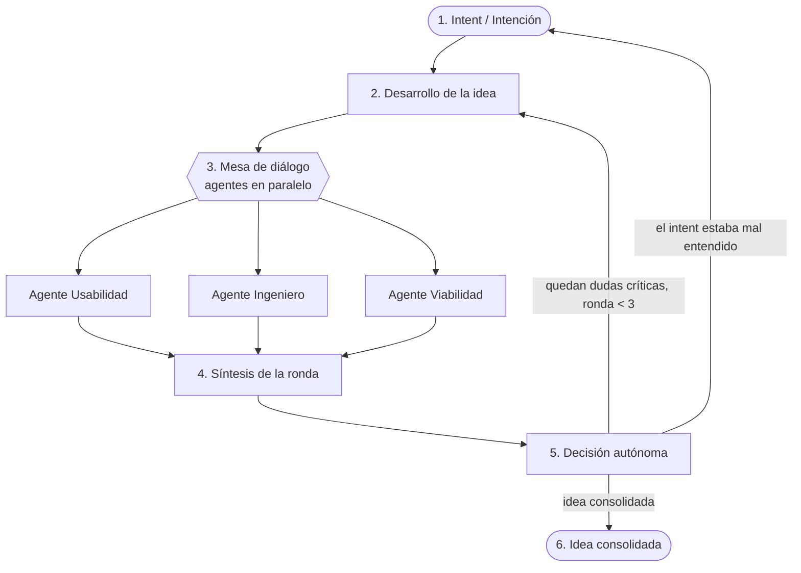
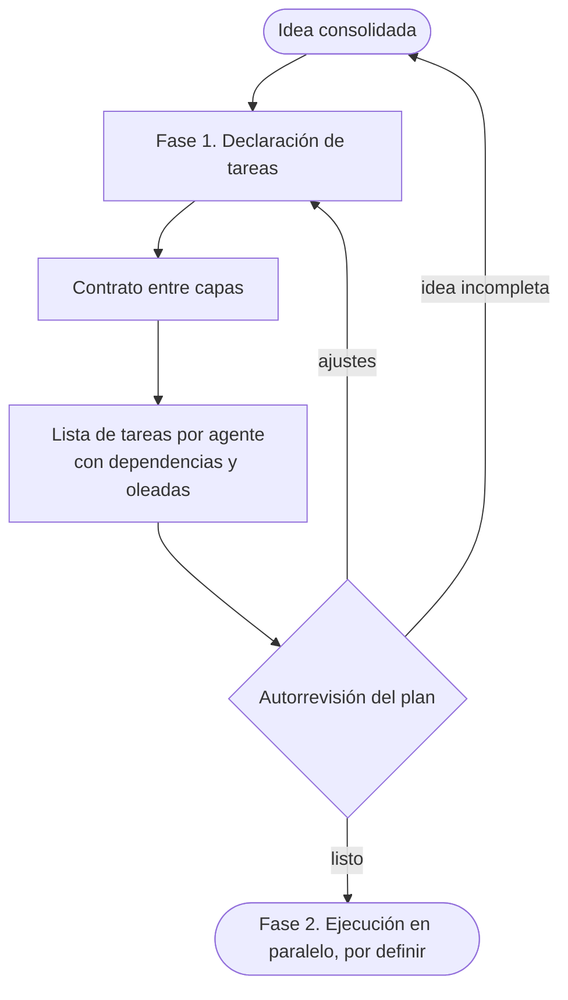
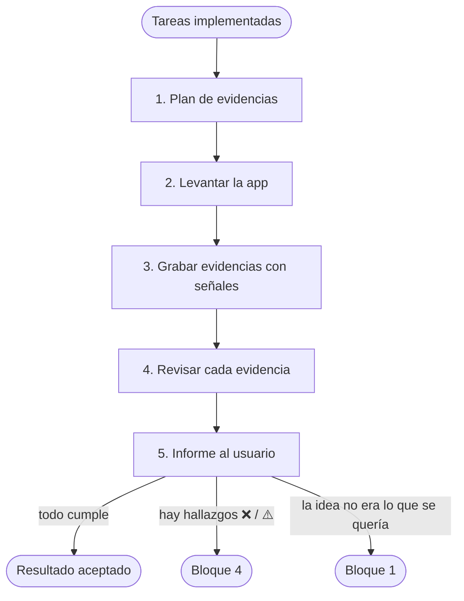
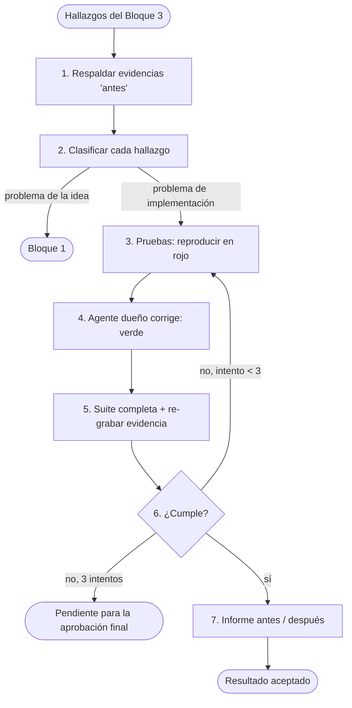
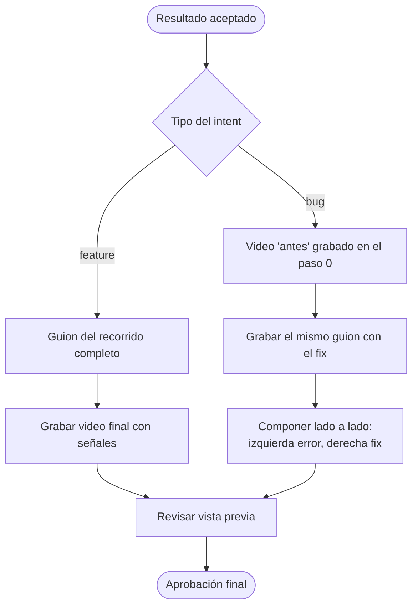

@AGENTS.md

# Modo autónomo (aplica a todos los bloques)

Todo el flujo corre **solo, de principio a fin**. El usuario da el pedido (o el ticket) una vez y la **única pregunta que se le hace es la aprobación final** del cambio (ver *Aprobación final* al final de este archivo). Donde este documento diga "el usuario responde", "espera la aprobación" o "escala al usuario", aplica esta regla:

1. **Decide tú.** Elige la opción más razonable según el `Intent`, el código existente y lo que dijeron los agentes. Ante la duda, elige la opción más simple y reversible que cumpla el intent.
2. **Regístralo.** Cada decisión va en `.flujo/decisiones.md` con el formato `- [fase] Pregunta → Decisión — porqué`. Ese registro se presenta completo en la aprobación final para que el usuario vea qué se decidió en su nombre.
3. **Continúa** con el siguiente nodo del grafo sin detenerte.

### Estado del recorrido y hooks

- Al entrar a **cada** fase, actualiza el estado: `node .claude/hooks/flujo.mjs fase <fase> [--slug <slug>] [--intent "<texto>"]`. Fases: `intent`, `idea`, `mesa`, `sintesis`, `respuesta`, `consolidada`, `implementacion`, `analisis`, `validacion`, `evidencia_final`, `aprobacion_final`, `terminado` (y `inactivo` para abortar un recorrido).
- Los hooks de `.claude/settings.json` hacen cumplir el modo autónomo mientras la fase no sea `aprobacion_final`, `terminado` o `inactivo`:
  - **PreToolUse** bloquea `AskUserQuestion` y `ExitPlanMode`: no se puede preguntar a mitad del flujo.
  - **Stop** no deja terminar el turno y pide continuar. Tras 3 empujes seguidos en la misma fase se suelta y marca `atascado: true`. En ese caso, registra el bloqueo y pasa a `aprobacion_final` explicándolo.
- `node .claude/hooks/flujo.mjs estado` muestra el estado actual. `.flujo/` está ignorada en git; cada worktree tiene la suya.
- **Si el usuario escribe a mitad del recorrido**, su mensaje manda: atiéndelo y retoma el flujo. Si pide detenerlo, pasa a la fase `inactivo`.

### Límites del modo autónomo

- Máximo **3 rondas** de mesa de diálogo y **1 vuelta** de regreso al Bloque 1 desde bloques posteriores. Al llegar al límite, se sigue con la mejor versión disponible y se registra.
- Nada sale de la máquina sin la aprobación final: sin `git push`, sin PRs, sin mensajes a servicios externos y sin borrar datos que no creó el propio recorrido. La única excepción es el PR del recorrido, que se crea **después** de un "Apruebo" (ver *Aprobación final*).

---

# Flujo de trabajo: de la intención a la idea

Todo trabajo en este proyecto sigue un **grafo**. Ningún nodo se salta: no se escribe código ni se propone solución técnica hasta que la idea haya pasado por la mesa de diálogo.



## 1. Intent (intención)

Punto de partida obligatorio. Extrae la intención del pedido o del ticket en una o dos frases: **qué se quiere lograr y para quién**, no cómo. **No se la preguntes al usuario.**

- Si el pedido llega como solución ("agrega un botón que..."), deduce la intención que hay detrás y regístrala como supuesto en `.flujo/decisiones.md`.
- Arranca el recorrido con `node .claude/hooks/flujo.mjs fase intent --slug <slug> --intent "<intent>"`.
- Escribe la intención textual al inicio de la conversación con el formato `**Intent:** ...` para que todos los agentes la usen como referencia fija.
- Registra también el tipo de trabajo: `**Tipo:** feature` (algo nuevo o un cambio) o `**Tipo:** bug` (algo que hoy funciona mal). El tipo define cómo será el video final del Bloque 5; si es un bug, el error se graba **antes** de tocar código (ver Bloque 5, paso 0).

## 2. Desarrollo de la idea

Con la intención registrada, desarrolla tú la idea: qué haría, cómo se vería, qué cambiaría para quien la use. Resúmela en un párrafo `**Idea (vN):** ...`, donde `N` es el número de ronda.

## 3. Mesa de diálogo (agentes en simultáneo)

Cada ronda, lanza **los tres agentes en paralelo, en un solo mensaje** (herramienta Agent, una llamada por agente). A cada uno pásale: el `Intent`, la última `Idea (vN)` y las decisiones registradas en rondas anteriores. Cada agente devuelve **máximo 3 preguntas o cuestionamientos**, concretos y priorizados. Ningún agente propone soluciones: solo cuestiona.

### Agente 1 — Usabilidad
Cuestiona la idea desde quien la va a usar.
- ¿Quién es exactamente el usuario y en qué momento la usa?
- ¿Qué tan fácil es entenderla la primera vez? ¿Qué pasos sobran?
- ¿Qué pasa cuando el usuario se equivoca, se pierde o abandona a medias?
- ¿Resuelve un problema real que el usuario siente, o uno que imaginamos?

### Agente 2 — Ingeniero (técnico, en lenguaje llano)
Cuestiona cómo se construiría, **sin jerga técnica**: habla de piezas, datos, dependencias y riesgos como se los explicaría a alguien que no programa.
- ¿Qué información necesita guardarse o moverse, y de dónde sale?
- ¿Qué partes ya existen en el proyecto y cuáles serían nuevas?
- ¿Qué podría romperse, quedar lento o ser difícil de mantener?
- ¿Hay una versión más simple que logre lo mismo?

### Agente 3 — Viabilidad y alineación con la intención
Cuestiona si vale la pena y si la idea sigue fiel al `Intent`.
- ¿Qué tan cerca está la idea actual de la intención original? (califica: **alta / media / baja** y explica por qué)
- ¿La idea se desvió, creció de más o se quedó corta respecto al intent?
- ¿El esfuerzo es proporcional al valor? ¿Qué se puede dejar fuera?
- ¿Hay supuestos que habría que validar antes de seguir?

> Hay espacio para un **cuarto agente** (por ejemplo negocio, seguridad o contenido). Cuando se defina, se agrega aquí y en el grafo con el mismo formato.

## 4. Síntesis de la ronda

Presenta las respuestas de los agentes **juntas, en un solo mensaje**, como una conversación de mesa:

```
### Ronda N
**🧭 Usabilidad:** ...
**🛠️ Ingeniero:** ...
**⚖️ Viabilidad:** (alineación con el intent: alta/media/baja) ...

**Puntos en común / tensiones:** ...
**Decisiones (autónomas):** 1. Pregunta → decisión — porqué. 2. ... 3. ...
```

Responde tú cada cuestionamiento con una decisión y cópialas a `.flujo/decisiones.md`. No esperes al usuario.

## 5. Decisión autónoma → siguiente nodo

Con tus decisiones de la ronda:
- **Queda algún cuestionamiento crítico sin resolver** y van menos de 3 rondas → actualiza `Idea (vN+1)` y haz otra ronda.
- **El intent estaba mal entendido** → vuelve al nodo 1, registra el nuevo `Intent` y deja visible el anterior.
- **Viabilidad marca alineación alta** sin cuestionamientos críticos, o se llegó a 3 rondas → pasa al nodo 6.

## 6. Idea consolidada

Entrega un resumen final con: `Intent`, `Idea final`, decisiones tomadas en cada ronda y preguntas que quedaron abiertas a propósito. Este resumen es la entrada del **Bloque 2: Implementación**.

## Reflejar la fase en el tablero

Cada recorrido del grafo vive en una tarjeta del tablero kanban, para que el equipo vea en qué fase va y **cuándo le toca a un humano**. Se hace con la herramienta MCP `actualizar_fase` del servidor `kanban` (requiere el tablero corriendo en `localhost:3000`).

- **Al registrar el Intent:** busca la tarjeta con `listar_tareas` y obtén su **id**. Si el recorrido viene de un ticket, usa esa tarjeta; si no hay una que coincida, sigue sin tablero y regístralo. Llama `actualizar_fase` con `fase: "intent"` y `responsable` (quien dio el intent). Desde ahí usa siempre el **id**, nunca el título.
- **En cada nodo**, al entrar, actualiza la fase:

| Nodo del grafo | `fase` | Turno |
|---|---|---|
| 1. Intent | `intent` | agente |
| 2. Desarrollo de la idea | `idea` | agente |
| 3. Mesa de diálogo | `mesa` | agente |
| 4. Síntesis de la ronda | `sintesis` | agente |
| 5. Decisión autónoma | `respuesta` | agente |
| 6. Idea consolidada y plan del Bloque 2 | `consolidada` | agente |
| Bloque 2 — al aprobarse el plan, durante la ejecución | `implementacion` | agente |
| Bloque 3 — al iniciar el análisis con evidencias | `analisis` | agente |
| Bloque 4 — al entrar a validación y corrección | `validacion` | agente |
| Bloque 5 — al grabar y entregar el video final | `evidencia_final` | agente |
| Aprobación final (también si el recorrido se atascó) | `aprobacion_final` | **humano**: el único turno humano |

- Al aprobar, y una vez creado el PR, mueve la tarjeta a la columna **Hecho** del tablero (`mover_tarea`). Al rechazar, regresa a la fase que corresponda con el motivo del rechazo como `motivo`.
- Las fases del tablero viven en `src/lib/phases.ts` y las del hook en `.claude/hooks/flujo.mjs`. `src/lib/phases.test.ts` falla si una fase del tablero no existe en el hook. `terminado` e `inactivo` existen solo en el hook, porque son estados de control y no fases de la tarjeta.

- **Al retroceder** el `motivo` es obligatorio: escribe en una frase por qué. Ese motivo es el feedback que el equipo ve en la tarjeta.
  - En el Bloque 1 (de 5 a 2, o de 5 a 1): las dudas abiertas o el cambio de intención.
  - Desde el Bloque 4 de regreso a `implementacion`: el motivo es **el hallazgo** que se va a corregir (p. ej. "H1: el nombre de la fase se corta").
  - Desde cualquier bloque de regreso al Bloque 1 (la idea no era lo que se quería): por qué.
- El equipo ve estas fases como columnas en la pestaña **"Por fases"** del tablero; la columna sale de la fase, no se mueve a mano.
- Si la herramienta falla (tablero apagado o tarjeta inexistente), regístralo en `.flujo/decisiones.md` y continúa con el flujo; no lo bloquees.

---

# Bloque 2: Implementación

La implementación se divide en fases. Solo se entra a este bloque con una **Idea consolidada** (nodo 6). Si el `Tipo` es **bug**, antes de que cualquier agente escriba código se graba el video de reproducción del error (Bloque 5, paso 0). Si al declarar tareas aparece una duda de fondo sobre la idea, se regresa al Bloque 1 (máximo una vuelta) en lugar de improvisar la respuesta dentro del plan.



## Los agentes de implementación

Son tres agentes con **responsabilidades que no se cruzan**. Cada uno solo toca los archivos de su capa; si necesita algo de otra capa, lo pide a través del contrato, no lo escribe.

### Agente Visual (UI)
Implementa al 100% todo lo que se ve y con lo que se interactúa: componentes, páginas, layout, estilos (Tailwind), estados visuales (cargando, vacío, error), accesibilidad y responsive.
- **Su capa:** `src/components/`, `src/app/**/page.tsx`, `src/app/**/layout.tsx`, `src/app/globals.css`.
- Consume datos y acciones **solo** a través de los tipos y funciones definidos en el contrato. Nunca accede a la base de datos ni a la lógica directamente.

### Agente Lógica y Datos
Implementa todo lo que no es visual: modelos y tipos, persistencia, reglas de negocio, server actions, rutas de API, webhooks y el servidor MCP.
- **Su capa:** `src/lib/`, `src/app/actions.ts`, `src/app/api/`, `src/app/webhooks/`.
- Expone exactamente lo que dice el contrato. No escribe JSX ni estilos.

### Agente de Pruebas (TDD)
Dueño de la calidad. Trabaja **antes y después** de los otros dos, siguiendo el ciclo TDD:
1. **Rojo:** escribe las pruebas de una tarea a partir de sus criterios de aceptación, *antes* de que exista la implementación, y confirma que fallan.
2. **Verde:** el agente Visual o el de Lógica implementa lo mínimo para que esas pruebas pasen.
3. **Refactor y verificación:** vuelve a correr toda la suite, revisa que no haya regresiones y reporta lo que falle al agente dueño de la tarea.
- **Su capa:** archivos de prueba (`*.test.ts`, `*.test.tsx`) y la configuración de pruebas.
- Prueba la lógica con pruebas unitarias y la UI con pruebas de componente (renderizar e interactuar como lo haría el usuario).
- Los otros agentes **no modifican pruebas** para hacerlas pasar. Si creen que una prueba está mal, lo dicen y el agente de Pruebas decide.
- **Hoy el proyecto no tiene corredor de pruebas.** La primera vez que se use este bloque, la tarea `T0` es del agente de Pruebas: configurar uno (p. ej. Vitest + Testing Library) y agregar el script `test` en `package.json`.

## Fase 1: Declaración de tareas

El objetivo es romper la Idea consolidada en **tareas pequeñas que varios agentes puedan trabajar en paralelo sin pisarse**. En esta fase no se escribe código: solo se produce el plan.

### Paso 1. Definir el contrato entre capas
Antes de listar tareas, define lo que conecta la UI con la lógica, para que Visual y Lógica puedan avanzar al mismo tiempo:
- Tipos de datos nuevos o modificados (en `src/lib/types.ts`).
- Firmas de las funciones, server actions o endpoints que la UI va a llamar: nombre, qué reciben, qué devuelven y qué errores pueden ocurrir.

El contrato es la primera tarea de la lista y es del agente de Lógica. Mientras no exista, el agente Visual puede trabajar con datos de ejemplo que respeten esos tipos.

### Paso 2. Romper en tareas
Cada tarea debe cumplir con lo siguiente:
- **Pertenece a un solo agente** (Visual, Lógica o Pruebas). Si una tarea toca dos capas, se divide en dos.
- **Es pequeña:** se puede completar y probar por sí sola, idealmente tocando pocos archivos.
- **Tiene criterios de aceptación verificables**, redactados para que el agente de Pruebas pueda convertirlos directamente en pruebas.
- **Declara sus dependencias.** Dos tareas que modifican el mismo archivo no pueden ir en la misma oleada.

Por cada tarea de Visual o de Lógica existe una tarea de Pruebas que la precede (fase roja del TDD).

### Paso 3. Agrupar en oleadas
Ordena las tareas en **oleadas**: todas las tareas de una oleada se pueden ejecutar en paralelo y solo dependen de oleadas anteriores. Por lo general:
- **Oleada 0:** configuración de pruebas (si falta) y el contrato.
- **Oleada 1:** pruebas en rojo para las tareas de la oleada siguiente.
- **Oleadas 2…N:** Visual y Lógica en paralelo, cada una con sus pruebas ya escritas, y luego la verificación del agente de Pruebas.

### Paso 4. Presentar el plan
Escribe el plan con este formato en `.flujo/plan.md`, muéstralo en la conversación y **continúa a la Fase 2 sin esperar aprobación**. Antes, haz una autorrevisión: que cada tarea sea de un solo agente, que dos tareas de una misma oleada no toquen el mismo archivo y que cada criterio se pueda probar.

```
### Contrato
- Tipos: ...
- Funciones / acciones: `nombre(entrada) → salida` — errores posibles

### Tareas
| ID  | Agente  | Tarea | Criterios de aceptación | Depende de | Archivos | Oleada |
|-----|---------|-------|-------------------------|------------|----------|--------|
| T0  | Pruebas | ...   | ...                     | —          | ...      | 0      |
| T1  | Lógica  | Contrato ... | ...              | —          | ...      | 0      |
| T2  | Pruebas | Pruebas (rojo) de T4 | ...      | T0, T1     | ...      | 1      |
| T3  | Pruebas | Pruebas (rojo) de T5 | ...      | T0, T1     | ...      | 1      |
| T4  | Lógica  | ...   | ...                     | T2         | ...      | 2      |
| T5  | Visual  | ...   | ...                     | T3         | ...      | 2      |

### Riesgos y preguntas abiertas
- ...
```

## Fase 2 en adelante

Por definir (ejecución en paralelo, integración, revisión).

---

# Bloque 3: Análisis con evidencias

Cuando los agentes de implementación terminan, **siempre** se analiza el resultado viéndolo funcionar en la app real, no solo leyendo el código o confiando en las pruebas. El entregable de este bloque son capturas y videos con **señales** que apuntan al punto de interés, más un veredicto por tarea.



## Herramientas (ya configuradas en el repo)

- **Playwright** (`@playwright/test`) con `playwright.config.ts`: busca archivos `evidencia/**/*.evidencia.ts` y deja todo en `evidencia/salidas/` (carpeta ignorada en git).
- **`evidencia/senales.ts`**: funciones para señalar el punto de interés. Úsalas siempre en lugar de dibujar a mano:

| Función | Para qué |
|---|---|
| `marcar(locator, etiqueta, { n, tono })` | Recuadro numerado con etiqueta alrededor de un elemento. `tono`: `foco` (naranja, punto de interés), `ok` (verde, cumple), `error` (rojo, problema), `info` (azul, contexto). |
| `leyenda(page, texto)` | Banda fija abajo que explica qué se está viendo. En videos, cámbiala en cada paso. |
| `mostrarCursor(page)` | Cursor visible y onda en cada clic (Playwright no graba el puntero). Llámala **antes** de `page.goto`. Obligatoria en videos. |
| `limpiar(page)` | Quita todas las señales antes de pasar al siguiente punto de interés. |
| `capturar(page, testInfo, nombre, completa?)` | Guarda la captura PNG en la carpeta de salida de esa evidencia. |
| `pausa(page, ms)` | Da ritmo legible al video entre pasos. |

- Ejemplos de referencia para copiar: `evidencia/ejemplo-captura.evidencia.ts` y `evidencia/ejemplo-video.evidencia.ts`.
- Se corre con `npm run evidencia` (o `npx playwright test evidencia/<archivo>` para una sola).

## 1. Plan de evidencias

Por cada tarea de Visual o de Lógica del plan aprobado, define qué evidencia demuestra su criterio de aceptación:
- **Captura** cuando lo que importa es un **estado**: cómo se ve una pantalla, un estado vacío, un error, un dato guardado y mostrado.
- **Video** cuando lo que importa es una **interacción o un cambio en el tiempo**: un flujo de varios pasos, arrastrar y soltar, una animación, algo que aparece después de una acción.
- Las tareas de pura lógica sin pantalla se evidencian por su efecto visible en la UI. Si no tienen ninguno, la evidencia es la salida de las pruebas (`npm test`) y se dice así en el informe.

## 2. Levantar la app

1. Revisa si ya corre: `curl -s -o /dev/null -w "%{http_code}" http://localhost:3000`. Si responde 200, **reutilízala; no la reinicies** (el tablero y el servidor MCP pueden estar en uso).
2. Si no corre, no hace falta levantarla a mano: Playwright ejecuta `npm run dev` solo (`webServer` en `playwright.config.ts`).
3. Si la app no compila o la página muestra un error, eso **ya es un hallazgo**: captúralo, repórtalo y no sigas con el resto de evidencias.

## 3. Grabar evidencias con señales

Crea un archivo por evidencia: `evidencia/<id-tarea>-<slug>.evidencia.ts` (p. ej. `T5-badge-de-fase.evidencia.ts`).

Reglas:
- **Cada evidencia tiene al menos una señal** (`marcar`) sobre el punto de interés y una `leyenda` que diga qué se está demostrando. Una captura sin señal no sirve como evidencia.
- **Numera** las señales (`n: 1, 2, 3…`) en el orden en que hay que mirarlas.
- **El color comunica el veredicto:** `ok` si cumple, `error` si no, `foco` mientras solo se señala.
- **Videos:** `test.use({ video: { mode: "on", size: { width: 1280, height: 800 } } })` va al **nivel superior del archivo** (Playwright no lo acepta dentro de `describe`). Usa `mostrarCursor`, una `leyenda` por paso y `pausa` entre pasos.
- Ubica elementos por rol, texto o etiqueta accesible (`getByRole`, `getByPlaceholder`, `getByText`), igual que las pruebas de componente.
- Incluye un `expect` del resultado esperado: si falla, la evidencia también lo registra.
- **No ensucies los datos reales.** Si la evidencia necesita crear algo, usa un título con el prefijo `[evidencia]` y bórralo al final. Nunca borres ni modifiques datos que no creó la evidencia.

## 4. Revisar cada evidencia

Abre **cada** captura con la herramienta Read y míralas antes de reportar. Comprueba que la señal cae sobre el elemento correcto, que no tapa lo importante y que lo que se ve cumple el criterio de aceptación. Si la señal quedó mal ubicada, corrige el selector y vuelve a grabar. Los videos (`.webm`) no se pueden ver con Read: verifica su flujo con capturas de los pasos clave dentro del mismo archivo.

## 5. Informe al usuario

Presenta el resultado con este formato:

```
### Análisis con evidencias
| Tarea | Criterio | Evidencia | Veredicto |
|-------|----------|-----------|-----------|
| T5 | ... | evidencia/salidas/<carpeta>/01-....png | ✅ cumple / ❌ no cumple / ⚠️ parcial |

**Hallazgos:** qué falla, en qué paso y qué señal lo muestra.
**Siguiente paso:** aceptar el resultado, pasar los hallazgos al Bloque 4 o revisar la idea (Bloque 1).
```

- Da las **rutas completas** de cada captura y video para que el usuario los abra.
- Si una tarea no cumple, el informe dice qué agente es dueño del problema (Visual, Lógica o Pruebas) y por qué. No arregles el código en este bloque: el análisis solo observa y reporta; la corrección ocurre en el Bloque 4.

---

# Bloque 4: Validación y corrección de evidencias

Entra aquí cuando el informe del Bloque 3 tiene al menos un hallazgo ❌ o ⚠️. El objetivo es **resolver cada problema y demostrarlo con la misma evidencia que lo detectó**: un hallazgo solo se cierra cuando la evidencia "después" muestra que se cumple el criterio de aceptación.



## 1. Respaldar las evidencias "antes"

Playwright **vacía `evidencia/salidas/` en cada corrida**, así que antes de tocar nada copia las evidencias con hallazgos:

```
mkdir -p evidencia/historial/<AAAA-MM-DD>-ronda-<N>/antes
cp -R evidencia/salidas/<carpeta-de-la-evidencia> evidencia/historial/<AAAA-MM-DD>-ronda-<N>/antes/
```

`evidencia/historial/` está ignorada en git, igual que `salidas/`.

## 2. Clasificar cada hallazgo

Por cada hallazgo decide, con la evidencia en la mano:

| Tipo | Señal | A dónde va |
|---|---|---|
| **Visual** | Se ve mal, falta un estado, no responde a la interacción, problema de accesibilidad o de responsive | Agente Visual |
| **Lógica y datos** | El dato es incorrecto, no se guarda, error del servidor, la acción no tiene efecto | Agente Lógica y Datos |
| **Prueba equivocada** | La app hace lo correcto pero la prueba o el criterio estaba mal escrito | Agente de Pruebas |
| **Evidencia mal hecha** | Selector equivocado, señal fuera de lugar, falta una `pausa` | Se corrige la evidencia (Bloque 3), no el código |
| **Problema de la idea** | Funciona como se pidió, pero lo que se pidió no resuelve el intent | Regresa al Bloque 1 (máximo una vuelta) y regístralo |

Si no está claro a qué capa pertenece, investiga la causa (revisa el código, la consola del navegador o los logs del servidor) antes de asignarlo. **No adivines la causa: confírmala.**

## 3–4. Corregir con TDD

Se usan los mismos agentes del Bloque 2, con las mismas reglas de capas:
1. **Rojo (agente de Pruebas):** escribe una prueba que reproduce el hallazgo y confirma que falla. Si el hallazgo no se puede expresar como prueba de componente o unitaria (p. ej. algo puramente de apariencia), la evidencia de Playwright con su `expect` cumple ese papel.
2. **Verde (agente dueño):** corrige lo mínimo para que la prueba pase, sin tocar archivos de otra capa ni modificar pruebas.
3. Hallazgos de capas distintas que no tocan los mismos archivos se corrigen **en paralelo** (agentes lanzados en un solo mensaje). Los que comparten archivos van uno después de otro.

## 5. Verificar sin regresiones

1. Corre la suite completa: `npm test`. Todo debe pasar, no solo la prueba nueva.
2. Re-graba **la misma evidencia** que detectó el hallazgo: `npx playwright test evidencia/<archivo>.evidencia.ts`. No cambies el escenario para que "pase": el escenario es el mismo; solo cambia el tono de la señal a `ok` si ahora cumple.
3. Corre también el resto de evidencias (`npm run evidencia`) para detectar que la corrección no rompió otra pantalla.
4. Abre con Read cada captura nueva y compárala con su versión "antes".

## 6. ¿Cumple?

- **Sí** → copia la evidencia nueva a `evidencia/historial/<…>-ronda-<N>/despues/` y cierra el hallazgo.
- **No** → regresa al paso 3 con lo aprendido. Máximo **3 intentos por hallazgo**. Al tercero, márcalo como **pendiente** en `.flujo/decisiones.md` con lo que se intentó, lo que se observó en cada intento y la causa probable, y sigue con el resto. Se presenta en la aprobación final.
- **La corrección creó un problema nuevo** → se registra como hallazgo nuevo y entra a este mismo bloque.

## 7. Informe antes / después

```
### Validación de evidencias — ronda N
| Hallazgo | Tipo / agente | Causa | Corrección | Antes | Después | Estado |
|----------|---------------|-------|------------|-------|---------|--------|
| H1 (T5) | Visual | ... | ... | evidencia/historial/.../antes/... | evidencia/historial/.../despues/... | ✅ resuelto / ❌ pendiente |

**Pruebas:** `npm test` → X pasaron, Y fallaron.
**Evidencias:** `npm run evidencia` → X pasaron, Y fallaron.
**Pendientes:** ...
```

- Da las **rutas completas** de cada par antes/después.
- Reporta con honestidad: si algo sigue fallando, se dice con la salida real; un hallazgo no se marca ✅ sin su evidencia "después".
- Se pasa al Bloque 5 cuando todos los hallazgos están ✅ o los que quedan están marcados como pendientes. El usuario decide sobre ellos en la aprobación final.

---

# Bloque 5: Evidencia final

Cierra el recorrido. Cuando el resultado está aceptado (Bloque 3 sin hallazgos, o Bloque 4 con todo ✅), se genera **un solo video con señales que muestra lo que se trabajó**, de principio a fin. Es el entregable que se comparte con el equipo.



## Herramientas

- `portada(page, titulo, lineas, ms)` en `evidencia/senales.ts`: tarjeta a pantalla completa para abrir y cerrar el video.
- `evidencia/componer.mjs`: une dos videos **lado a lado** (izquierda roja "❌ Antes: reproducción del error", derecha verde "✅ Después: con el fix"), los reproduce sincronizados y graba el resultado en un `.webm` de 1920×720. No necesita ffmpeg. También guarda una **vista previa `.png`** a la mitad del video.
  ```
  node evidencia/componer.mjs <antes.webm> <despues.webm> <salida.webm> "<título>"
  ```
- Los entregables van en `evidencia/entregables/<AAAA-MM-DD>-<slug>/` (ignorada en git, porque son archivos pesados).

## Paso 0 (solo bugs): grabar la reproducción antes de tocar código

Se hace **al entrar al Bloque 2, antes de cualquier cambio**, porque después del fix ya no se puede grabar el error:
1. Escribe el guion final: `evidencia/final-<slug>.evidencia.ts`. Reproduce el error paso a paso, con `mostrarCursor`, una `leyenda` por paso y `marcar(..., { tono: "error" })` sobre el punto donde falla. El guion debe ser **neutral**: los mismos pasos tienen que servir para mostrar el error y el fix. Pon la señal en el lugar del problema con una etiqueta que valga para ambos casos (p. ej. "Contador de tareas"), y el veredicto lo da cada lado del video.
2. No pongas un `expect` que falle con el error: la reproducción debe terminar completa. Comprueba el resultado esperado solo con `leyenda` y señales.
3. Grábalo y guárdalo:
   ```
   npx playwright test evidencia/final-<slug>.evidencia.ts
   mkdir -p evidencia/entregables/<AAAA-MM-DD>-<slug>
   cp evidencia/salidas/<carpeta>/video.webm evidencia/entregables/<AAAA-MM-DD>-<slug>/antes.webm
   ```
4. Si el error no se reproduce, **no toques código**: sin reproducción no hay bug confirmado. Regístralo y pasa directo a `aprobacion_final` con lo que se intentó para reproducirlo.

Si alguien olvidó el paso 0 y el fix ya está aplicado, la alternativa es levantar la versión anterior en otro puerto (un `git worktree` del commit previo al fix, con su propio `npm install`, en `PORT=3001`) y grabar el guion contra esa URL con `EVIDENCIA_URL=http://localhost:3001 npx playwright test evidencia/final-<slug>.evidencia.ts`. Regístralo en `.flujo/decisiones.md` cuando se use este camino.

## Feature: video del recorrido completo

1. Escribe `evidencia/final-<slug>.evidencia.ts` con `test.use({ video: ... })` al nivel superior, igual que en el Bloque 3.
2. Estructura del video:
   - **Portada:** `portada(page, "<Intent>", ["Tipo: feature", "<qué se construyó en una línea>"])`.
   - **Recorrido:** cubre **cada tarea** de Visual y de Lógica del plan aprobado en el orden en que las usaría una persona real, no en el orden del plan. Para cada una: `leyenda` con lo que se demuestra, `marcar` numerado sobre el punto de interés con `tono: "ok"`, `pausa` para que se lea y `limpiar` antes del siguiente.
   - **Cierre:** `portada(page, "Resultado", ["T4 ✅ ...", "T5 ✅ ..."])` con una línea por tarea.
3. Usa `mostrarCursor` siempre. Los datos que cree el video llevan el prefijo `[evidencia]` y se borran al final.
4. Graba y copia: `cp evidencia/salidas/<carpeta>/video.webm evidencia/entregables/<AAAA-MM-DD>-<slug>/final.webm`.

## Bug: video a dos pantallas

1. Con el fix aplicado, corre **el mismo guion** del paso 0 sin cambiarle pasos y guarda el video como `despues.webm`.
2. Compón el video final:
   ```
   node evidencia/componer.mjs \
     evidencia/entregables/<AAAA-MM-DD>-<slug>/antes.webm \
     evidencia/entregables/<AAAA-MM-DD>-<slug>/despues.webm \
     evidencia/entregables/<AAAA-MM-DD>-<slug>/final.webm \
     "<Intent>"
   ```
3. Izquierda siempre es el error y derecha siempre es el fix. Ambos lados avanzan sincronizados porque usan el mismo guion.

## Revisar antes de entregar

Read no puede ver `.webm`, así que:
- **Bug:** abre `final-vista-previa.png` (la genera `componer.mjs`) y confirma que ambos lados se ven, que el error se nota a la izquierda y que el fix se nota a la derecha en el mismo momento.
- **Feature:** agrega dentro del guion una `capturar(...)` en cada punto de interés y revísalas todas con Read.
- Si alguna señal tapa lo importante, la leyenda no se lee o falta una tarea, corrige el guion y vuelve a grabar.

## Entrega

```
### Evidencia final
**Intent:** ...   **Tipo:** feature | bug
**Video:** /ruta/completa/evidencia/entregables/<AAAA-MM-DD>-<slug>/final.webm
**Vista previa:** /ruta/completa/...png
**Qué se ve:** 1) ... 2) ... 3) ...   (una línea por señal numerada / tarea)
```

- Da siempre las **rutas completas**. El `.webm` se abre en cualquier navegador (arrástralo a una pestaña de Chrome).
- El video final no sustituye al informe del Bloque 3/4: lo resume para quien no estuvo en el proceso.

no quiero que escribas codigo de la siguiente
---

# Aprobación final

Es el **único** punto donde se le pregunta algo al usuario. Se llega aquí después del Bloque 5, o antes si el recorrido quedó atascado o el bug no se reprodujo.

1. Pasa a la fase: `node .claude/hooks/flujo.mjs fase aprobacion_final`. Con eso los hooks permiten preguntar y detenerse.
2. Presenta un solo resumen:

```
### Aprobación final — <slug>
**Intent:** ...   **Tipo:** feature | bug
**Qué se hizo:** 2–4 líneas.
**Video final:** /ruta/completa/...final.webm   **Vista previa:** /ruta/completa/...png
**Pruebas:** `npm test` → X pasaron, Y fallaron.   **Evidencias:** X pasaron, Y fallaron.
**Decisiones tomadas por mí:** (de .flujo/decisiones.md, las relevantes)
**Pendientes / riesgos:** hallazgos sin resolver, bloqueos, supuestos.
**Archivos cambiados:** lista breve.
**Al aprobar:** se sube la rama `<rama>` y se crea el PR contra `main` (o se actualiza el que ya existe).
```

3. Pregunta con `AskUserQuestion`, **una sola pregunta**: "¿Apruebas el cambio? Al aprobar se sube la rama y se crea el PR." con las opciones **Apruebo** / **No apruebo** (el usuario explica por qué en "Other" o en las notas).
4. Según la respuesta:
   - **Apruebo** → crea el PR del recorrido (paso 5) y pasa a `terminado`.
   - **No apruebo** → su motivo es el nuevo insumo. Regístralo y decide a qué bloque regresar: idea → Bloque 1, plan o implementación → Bloque 2, algo que se ve mal → Bloque 4. Actualiza la fase con el `motivo` en el tablero y **vuelve al modo autónomo** hasta una nueva aprobación final.
5. **Crear el PR** (solo después de "Apruebo"):
   1. **Rama:** usa la rama actual del worktree; si estás en `main`, crea `flujo/<slug>`.
   2. **Commit** de los cambios del recorrido (sin `.flujo/` ni `evidencia/salidas|historial|entregables`, que están ignoradas).
   3. **Push:** `git push -u origin <rama>`.
   4. **PR:** si la rama ya tiene uno (`gh pr view --json url`), reutilízalo: el push ya lo actualizó y no se crea otro. Si no, `gh pr create --base main --title "<título del ticket o el Intent>" --body "<resumen de la aprobación final>"`. El cuerpo lleva el `Intent`, qué se hizo, las pruebas, las decisiones relevantes, los pendientes y, si viene de un ticket, `Ticket: <id>`.
   5. **Entrega:** da el enlace del PR en la conversación y registra la URL en `.flujo/decisiones.md`. Después mueve la tarjeta a **Hecho** (`mover_tarea`).
   6. **Si algo falla** (no hay `gh`, no hay sesión, no hay remoto o hay un conflicto con el push): el commit queda local, muestra el error real, registra el pendiente en `.flujo/decisiones.md` y **no** muevas la tarjeta a Hecho. No reintentes con `--force`.
